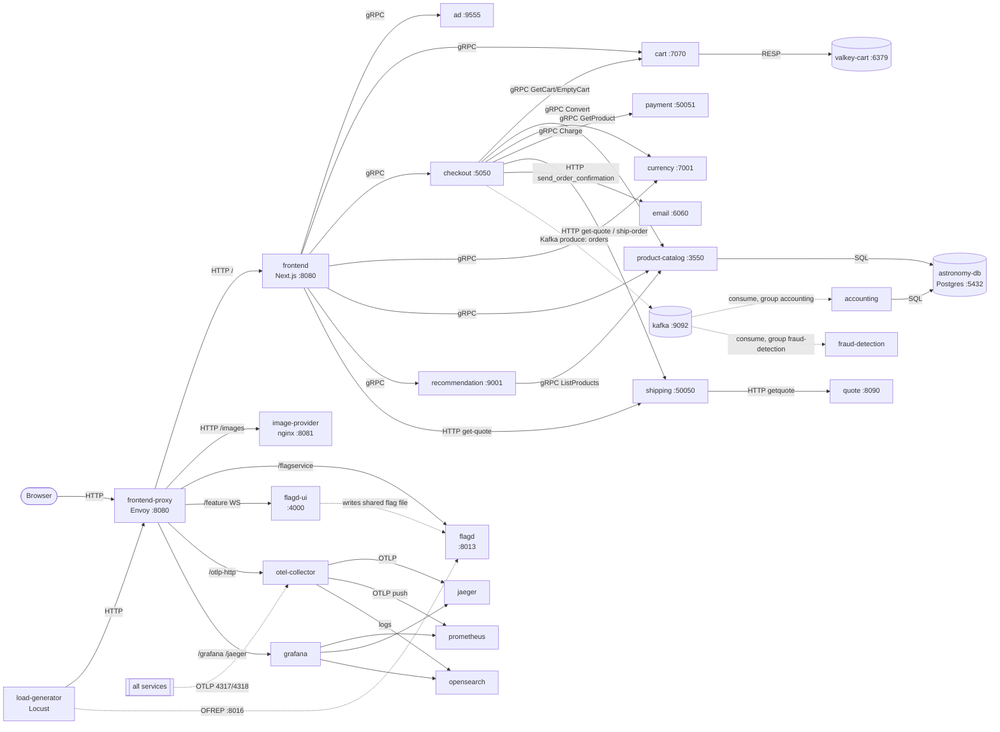

# Service map

> **Provenance.** This analysis describes the application source at fork commit [`85c2cb25`](https://github.com/samimassoud/opentelemetry-demo/commit/85c2cb253ae3519ef2b3a02984c32614106de5ea) (`samimassoud/opentelemetry-demo`, based on upstream release `3.1.0` of [`open-telemetry/opentelemetry-demo`](https://github.com/open-telemetry/opentelemetry-demo)). Paths are relative to the application root: `opentelemetry-demo/` in the current workspace, `app/astronomy-shop/` once the source is imported into this repository.

This is every component of the Astronomy Shop: what it is, what it exposes, what it depends on, what it stores, and where it would run on Azure.

## Sources and conventions

- **Code and compose are the source of truth.** The inputs are `src/`, `pb/demo.proto`, every `compose*.yaml`, `.env` and the `Makefile` at commit `85c2cb25`. Paths are relative to `opentelemetry-demo/`. Where a service README disagrees with the code, the doc follows the code and marks the difference **Doc ≠ code**.
- **"not found"** means the value is not present in code, compose or `.env`.
- **Compose layering.** `make start` combines `compose.yaml` + `compose.full.yaml` + `compose.observability.yaml` + `compose.extras.yaml` (`Makefile:33`, `:313-322`). `compose.extras.yaml` defines no services. Components that only exist in `compose.agent.yaml` or `compose.profiling.yaml` are marked **optional**.
- **Not covered:** `frontendTests` (`compose.tests.yaml`) is a Cypress test harness, not part of the running shop.
- **Persistence.** Nothing in compose mounts a data volume. Postgres, Valkey, Kafka, Prometheus, OpenSearch and Jaeger all start empty every time.
- **Azure terms.** The first use of each Azure term gives its nearest AWS equivalent in parentheses.

### Shared env vars, defined once here

Most services also read the standard OpenTelemetry SDK variables. To keep the per-component tables short, they are listed once here and referenced as **OTel set A** or **OTel set B**.

| Name | Purpose | Default from `.env` |
|---|---|---|
| `OTEL_EXPORTER_OTLP_ENDPOINT` | Where the SDK sends OTLP | **Set A:** `http://otel-collector:4317`, gRPC (`.env:39`). **Set B:** compose overrides it to `http://otel-collector:4318`, HTTP (`.env:32,34`) |
| `OTEL_SERVICE_NAME` | `service.name` | Literal per service in compose |
| `OTEL_RESOURCE_ATTRIBUTES` | Resource attributes | `service.namespace=opentelemetry-demo,service.version=3.1.0` (`.env:43-44`), plus `service.criticality=<level>` per service |
| `OTEL_EXPORTER_OTLP_METRICS_TEMPORALITY_PREFERENCE` | Metric temporality | `cumulative` (`.env:47`) |
| `OTEL_EXPORTER_OTLP_METRICS_DEFAULT_HISTOGRAM_AGGREGATION` | Histogram type | `explicit_bucket_histogram` (`.env:48`) |
| `FLAGD_HOST` / `FLAGD_PORT` | flagd address, read by the OpenFeature flagd provider library | `flagd` / `8013` (`.env:143-144`) |

**Which services use which set:**

| Set | Services |
|---|---|
| A (gRPC 4317) | cart, currency, frontend, load-generator, payment, product-catalog |
| B (HTTP 4318) | ad, checkout, email, quote, recommendation, shipping, flagd, flagd-ui, accounting, fraud-detection, kafka, chatbot |

---

## Request and event flow

How to read the diagram:
- Solid edges are synchronous requests.
- Dashed edges are asynchronous: Kafka events, flag-file writes and telemetry.
- Every backend service also evaluates flags against `flagd:8013`. Those edges are left out to keep the diagram readable; see each component's **Feature flags** field.

---

## Edge

### frontend-proxy
- **Path in repo:** `src/frontend-proxy/` (Envoy config template `envoy.tmpl.yaml`). Compose service `frontend-proxy`, `compose.yaml:321-384`. Patched by `compose.observability.yaml:169-176` and `compose.agent.yaml:138-141`.
- **Language / runtime:** Envoy `envoyproxy/envoy:v1.39.3`. The container runs `envsubst` on the template at start (`Dockerfile:4,21`).
- **Role in the shop:** The single entry point for browsers and the load generator. It routes by path to the web app, images, flags, telemetry intake and the observability UIs.
- **Exposes:**
  - HTTP on `ENVOY_PORT` 8080. Compose publishes it as a fixed host port.
  - Envoy admin on `ENVOY_ADMIN_PORT` 10000, which includes `/stats/prometheus`.
  - Contract: path routes, in order (`envoy.tmpl.yaml:39-96`):

    | Path | Upstream | Note |
    |---|---|---|
    | `/loadgen/` | load-generator | prefix rewritten to `/` |
    | `/otlp-http/` | collector :4318 | |
    | `/jaeger/` | jaeger | |
    | `/grafana/` | grafana | |
    | `/opamp/` | opamp-server UI | |
    | `/telemetry/` | telemetry-docs | |
    | `/images/` | image-provider | |
    | `/flagservice/` | flagd :8013 | timeout 0 |
    | `/feature` | flagd-ui | websocket |
    | `/profiles/` | firepit | |
    | `/chatbot/` | chatbot | websocket |
    | `/` | frontend | catch-all |

  - An HTTP fault filter applies the `x-envoy-fault-delay-request` header delay to 100% of requests (`:98-105`).
- **Calls:**
  - frontend, image-provider, flagd, flagd-ui, load-generator, otel-collector (HTTP), jaeger, grafana, opamp-server, telemetry-docs, firepit, chatbot.
  - Its own traces and access logs go to the collector over gRPC (`:17-31`, `:109-163`).
  - All clusters are `STRICT_DNS`, so every upstream hostname must resolve, even for optional services that aren't deployed.
- **Env vars it reads:**

  | Name | Purpose | Default (.env) |
  |---|---|---|
  | `ENVOY_ADDR` / `ENVOY_PORT` / `ENVOY_ADMIN_PORT` | Listener address and ports | `0.0.0.0` / `8080` / `10000` (`.env:86-88`) |
  | `FRONTEND_HOST` / `FRONTEND_PORT` | `/` upstream | `frontend` / `8080` (`.env:89,94`) |
  | `IMAGE_PROVIDER_HOST` / `IMAGE_PROVIDER_PORT` | `/images` upstream | `image-provider` / `8081` (`.env:99-100`) |
  | `FLAGD_HOST` / `FLAGD_PORT` | `/flagservice` upstream | `flagd` / `8013` |
  | `FLAGD_UI_HOST` / `FLAGD_UI_PORT` | `/feature` upstream | `flagd-ui` / `4000` (`.env:148-149`) |
  | `LOCUST_WEB_HOST` / `LOCUST_WEB_PORT` | `/loadgen` upstream | `load-generator` / `8089` (`.env:104,107`) |
  | `OTEL_COLLECTOR_HOST` / `_PORT_GRPC` / `_PORT_HTTP` | Tracing sink and `/otlp-http` upstream | `otel-collector` / `4317` / `4318` (`.env:32-34`) |
  | `GRAFANA_HOST` / `GRAFANA_PORT` | `/grafana` upstream | `grafana` / `3000` (`.env:175-176`) |
  | `JAEGER_HOST` / `JAEGER_UI_PORT` | `/jaeger` upstream | `jaeger` / `16686` (`.env:179-180`) |
  | `OPAMP_SERVER_HOST` / `OPAMP_SERVER_UI_PORT` | `/opamp` upstream | `opamp-server` / `4321` (`.env:219-220`) |
  | `TELEMETRY_DOCS_HOST` / `_PORT` | `/telemetry` upstream | `telemetry-docs` / `8000` (`.env:228-229`) |
  | `FIREPIT_HOST` / `FIREPIT_PORT` | `/profiles` upstream | `firepit` / `8080` (`.env:224-225`) |
  | `CHATBOT_HOST` / `CHATBOT_PORT` | `/chatbot` upstream | `chatbot` / `7860` (`.env:199-200`) |
  | `OTEL_SERVICE_NAME` / `OTEL_SERVICE_NAMESPACE` | Tracer resource | `frontend-proxy` (compose) / `opentelemetry-demo` (`.env:43`) |

- **Feature flags it evaluates:** none directly. It *applies* the `imageSlowLoad` delay that the browser sends as a header.
- **Consumes / produces:** n/a.
- **State:** none.
- **Azure path:** **Stays on AKS** (≈ EKS) as the backend of a Gateway API `HTTPRoute`. TLS terminates at the Gateway, and frontend-proxy stays plain HTTP inside the cluster.
  - The managed Gateway API implementation is Application Gateway for Containers (≈ AWS Load Balancer Controller + ALB); choosing it is open.
  - What changes: config only (env vars). Because of `STRICT_DNS`, either deploy the optional upstreams or point their hostnames somewhere that resolves.
  - Auth: none. Networking: in-cluster only.

---

## Web tier

### frontend
- **Path in repo:** `src/frontend/`. Compose service `frontend`, `compose.yaml:253-318`.
- **Language / runtime:** TypeScript, Next.js 16.4.0 / React 19.3.0, pages router, `output: standalone`. Build image `node:25.9.0-slim`, runtime `gcr.io/distroless/nodejs24-debian13:nonroot` (`Dockerfile:4,45`).
- **Role in the shop:** Renders the storefront, and serves the `/api/*` routes the browser calls. Each route fans out to the backend services.
- **Exposes:** HTTP on `PORT` (= `FRONTEND_PORT` 8080).
  - Pages: `/`, `/product/[productId]`, `/cart`, `/cart/checkout/[orderId]`.
  - API routes:
    - `GET/POST/DELETE /api/cart`
    - `POST /api/checkout`
    - `GET /api/currency`
    - `GET /api/data` (ads)
    - `GET /api/products`, `GET /api/products/[productId]`
    - `GET /api/recommendations`
    - `GET /api/shipping`
- **Calls:**
  - gRPC (`@grpc/grpc-js`, insecure): ad, cart, checkout, currency, product-catalog, recommendation (`gateways/rpc/*.gateway.ts`).
  - HTTP: shipping `POST /get-quote` (`gateways/http/Shipping.gateway.ts:31`).
  - otel-collector over OTLP gRPC.
  - **The browser itself** calls `/flagservice`, `/images` and `/otlp-http` on the same origin. That makes frontend-proxy a hard runtime dependency.
- **Env vars it reads:**

  | Name | Purpose | Default (.env) |
  |---|---|---|
  | `PORT` | Listen port | `${FRONTEND_PORT}` = `8080` (`.env:94`) |
  | `FRONTEND_ADDR` | Own address | `frontend:8080` (`.env:95`) |
  | `AD_ADDR` | ad gRPC | `ad:9555` (`.env:58`) |
  | `CART_ADDR` | cart gRPC | `cart:7070` (`.env:64`) |
  | `CHECKOUT_ADDR` | checkout gRPC | `checkout:5050` (`.env:69`) |
  | `CURRENCY_ADDR` | currency gRPC | `currency:7001` (`.env:74`) |
  | `PRODUCT_CATALOG_ADDR` | product-catalog gRPC | `product-catalog:3550` (`.env:121`) |
  | `RECOMMENDATION_ADDR` | recommendation gRPC | `recommendation:9001` (`.env:131`) |
  | `SHIPPING_ADDR` | shipping HTTP | `http://shipping:50050` (`.env:136`) |
  | `PUBLIC_OTEL_EXPORTER_OTLP_TRACES_ENDPOINT` | Browser trace endpoint, injected into `window.ENV` | `http://localhost:8080/otlp-http/v1/traces` (`.env:40`) |
  | `WEB_OTEL_SERVICE_NAME` | Browser `service.name` | `frontend-web` (compose literal) |
  | `OTEL_COLLECTOR_HOST` | Trace endpoint used for synthetic (load-gen) page loads | `otel-collector` (`.env:32`) |
  | `ENV_PLATFORM` | Platform label shown in the footer | `local` (`.env:24`) |
  | `LOG_LEVEL` | pino log level (`utils/telemetry/logger.ts:7`) | not found in `.env` |
  | OTel set A | | |

- **Feature flags it evaluates:** `imageSlowLoad`. It is evaluated in the browser via `FlagdWebProvider` through `/flagservice` (`pages/_app.tsx:33-53`; `components/ProductCard/ProductCard.tsx:32`). `@openfeature/flagd-provider` is a dependency, but no server-side use was found.
- **Consumes / produces:** n/a.
- **State:** none on the server. The session id lives in browser storage.
- **Azure path:** **Stays on AKS.** The image would be pulled from Azure Container Registry (ACR ≈ ECR).
  - What changes: config only. `PUBLIC_OTEL_EXPORTER_OTLP_TRACES_ENDPOINT` must become `https://<public host>/otlp-http/v1/traces` behind the TLS-terminating Gateway.
  - Auth: none. Networking: in-cluster.

### image-provider
- **Path in repo:** `src/image-provider/`. Compose service `image-provider`, `compose.yaml:387-417`.
- **Language / runtime:** nginx `nginx-unprivileged:1.29.3-alpine3.22-otel` with the OTel nginx module (`Dockerfile:4`).
- **Role in the shop:** Serves the static product and banner images.
- **Exposes:** HTTP on `IMAGE_PROVIDER_PORT` 8081.
  - Static files from `/static` (`nginx.conf.template:22-31`).
  - `/status` (stub_status, `:34-38`). The collector's `nginx` receiver scrapes it.
- **Calls:** otel-collector (OTLP gRPC).
- **Env vars it reads:** substituted into the template with `envsubst` (`Dockerfile:17`).

  | Name | Purpose | Default (.env) |
  |---|---|---|
  | `IMAGE_PROVIDER_PORT` | Listen port | `8081` (`.env:100`) |
  | `OTEL_COLLECTOR_HOST` / `OTEL_COLLECTOR_PORT_GRPC` | Trace export | `otel-collector` / `4317` |
  | `OTEL_SERVICE_NAME` | Tracer name | `image-provider` (compose) |

- **Feature flags it evaluates:** none.
- **Consumes / produces:** n/a.
- **State:** none. Images are baked into the image.
- **Azure path:** **Stays on AKS.**
  - An alternative is Azure Blob Storage (≈ S3) with Azure Front Door (≈ CloudFront). That would mean changing the frontend's image loader and the proxy route, and you'd lose the `imageSlowLoad` fault path. Not recommended.
  - The template hard-codes `resolver 127.0.0.11` (Docker DNS). It's unused because there is no `proxy_pass`.

---

## Request-path services

### checkout
- **Path in repo:** `src/checkout/`. Compose service `checkout`, `compose.yaml:116-175`, extended by `compose.full.yaml:130-136`.
- **Language / runtime:** Go (`go.mod` go 1.26.0). Build `golang:1.27.2-bookworm`, runtime distroless static (`Dockerfile:5,24`).
- **Role in the shop:** Orchestrates a purchase: reads the cart, prices the items, quotes shipping, charges payment, ships, empties the cart, sends the email, then publishes the order to Kafka.
- **Exposes:** gRPC on `CHECKOUT_PORT` 5050.
  - Contract: `oteldemo.CheckoutService/PlaceOrder` (`pb/demo.proto:224-226`), plus gRPC health.
- **Calls:**
  - cart `GetCart` / `EmptyCart`, product-catalog `GetProduct`, currency `Convert`, payment `Charge`. All gRPC, insecure (`main.go:474-590`).
  - shipping `POST /get-quote` and `/ship-order` (HTTP/JSON, `:494`, `:631`).
  - email `POST /send_order_confirmation` (HTTP/JSON, `:604`).
  - Kafka, flagd, otel-collector.
  - **Doc ≠ code:** `demo.proto` defines `ShippingService` and `EmailService`. Checkout builds gRPC stubs for them (`main.go:218-241`) but never calls them; the real calls are HTTP.
- **Env vars it reads:**

  | Name | Purpose | Default (.env) |
  |---|---|---|
  | `CHECKOUT_PORT` | Listen port | `5050` (`.env:68`) |
  | `CART_ADDR` | cart gRPC | `cart:7070` |
  | `PRODUCT_CATALOG_ADDR` | product-catalog gRPC | `product-catalog:3550` |
  | `CURRENCY_ADDR` | currency gRPC | `currency:7001` |
  | `PAYMENT_ADDR` | payment gRPC | `payment:50051` (`.env:116`) |
  | `SHIPPING_ADDR` | shipping HTTP base URL | `http://shipping:50050` |
  | `EMAIL_ADDR` | email HTTP base URL | `http://email:6060` (`.env:79`) |
  | `KAFKA_ADDR` | Kafka bootstrap. Optional: if unset, nothing is published | `kafka:9092` (`.env:153-155`); only set by `compose.full.yaml` |
  | `KAFKA_TOPIC` | Topic name (code default `orders`, `kafka/producer.go:19`) | `orders` (`.env:156`) |
  | `GOMEMLIMIT` | Go soft memory limit | `16MiB` (compose literal) |
  | `OTEL_EXPORTER_OTLP_PROTOCOL` | OTLP protocol | `http/protobuf` (compose literal) |
  | OTel set B, `FLAGD_HOST`/`FLAGD_PORT` | | |

- **Feature flags it evaluates:**
  - `paymentUnreachable` (`main.go:575`): swaps the payment address to `badAddress:50051`.
  - `kafkaQueueProblems` (`:717`): **re-sends each order N times**.
  - `emitRawPii` (`:313`).
- **Consumes / produces:** **Produces** to topic `orders` (`KAFKA_TOPIC`).
  - Value: protobuf `oteldemo.OrderResult`. No message key. Trace context goes in the headers (`main.go:665-673`, `:750`).
  - Client: IBM/sarama v1.61.1, protocol version `V3_0_0_0`, `RequiredAcks=NoResponse` (`producer.go:15,49`).
  - `KAFKA_ADDR` is used as a single broker; it isn't split on commas (`main.go:251`).
  - **No SASL or TLS settings anywhere in the code.**
- **State:** none.
- **Azure path:** **Stays on AKS.** Its Kafka producer needs a change for any managed broker; see [Messaging](#1-messaging-kafka--event-hubs-or-service-bus).

### cart
- **Path in repo:** `src/cart/src/`. Compose service `cart`, `compose.yaml:80-113`, extended by `compose.observability.yaml:205-211`.
- **Language / runtime:** C#, .NET 10. Build `sdk:10.0.402`, runtime `runtime-deps:10.0.12-alpine3.23` (`Dockerfile:18,45`).
- **Role in the shop:** Stores each visitor's cart, keyed by session id.
- **Exposes:** gRPC, HTTP/2 only, on `ASPNETCORE_HTTP_PORTS` = `${CART_PORT}` 7070. The code never reads `CART_PORT` itself.
  - Contract: `oteldemo.CartService`, with RPCs `AddItem`, `GetCart`, `EmptyCart` (`pb/demo.proto:23-27`).
  - Also gRPC health and `GET /`.
- **Calls:**
  - valkey-cart (RESP) through StackExchange.Redis 3.4.5.
  - flagd.
  - opamp-server (optional, when `OPAMP_SERVER_ENDPOINT` is set).
  - otel-collector.
- **Env vars it reads:**

  | Name | Purpose | Default (.env) |
  |---|---|---|
  | `VALKEY_ADDR` | Valkey `host:port`. Required (`Program.cs:33`) | `valkey-cart:6379` (`.env:161`) |
  | `ASPNETCORE_HTTP_PORTS` | Kestrel listen port | `${CART_PORT}` = `7070` (`.env:63`) |
  | `OPAMP_SERVER_ENDPOINT` | OpAMP client target (observability stack only) | `wss://opamp-server:4320/v1/opamp` (compose) |
  | `OPAMP_SERVER_TLS_INSECURE_SKIP_VERIFY` | Skip TLS verification for OpAMP | `true` (compose) |
  | OTel set A, `FLAGD_HOST`/`FLAGD_PORT` | | |

- **Feature flags it evaluates:**
  - `cartFailure`: routes `EmptyCart` to `badhost:1234` (`CartService.cs:82`).
  - `cartMetricCardinalityOverflow` (`ValkeyCartStore.cs:202`).
  - `failedReadinessProbe`: gRPC health reports unhealthy (`HealthCheckService.cs:36`).
- **Consumes / produces:** n/a.
- **State:** **valkey-cart.**
  - Key = the raw user id. The value is a hash with field `cart` holding protobuf `oteldemo.Cart` bytes.
  - TTL 60 minutes, refreshed on add and empty (`ValkeyCartStore.cs:144-192`).
  - At startup it writes a probe key `cart`=`OK`.
- **Azure path:** **Stays on AKS.** Its store can move to Azure Managed Redis (see valkey-cart), but **that needs a code change**:
  - The connection string is built as `"{VALKEY_ADDR},ssl=false,allowAdmin=true,abortConnect=false"` (`ValkeyCartStore.cs:57`). The trailing `ssl=false` overrides any `ssl=true` passed in `VALKEY_ADDR`.
  - A `password=` can be passed through `VALKEY_ADDR`, but TLS cannot.
  - Entra ID auth (≈ IAM auth for ElastiCache) would also need the `Microsoft.Azure.StackExchangeRedis` package, which isn't referenced.

### product-catalog
- **Path in repo:** `src/product-catalog/`. Compose service `product-catalog`, `compose.yaml:518-565`, extended by `compose.observability.yaml:213-219`.
- **Language / runtime:** Go (go 1.26.0). Build `golang:1.27.2-bookworm`, runtime distroless static (`Dockerfile:5,23`).
- **Role in the shop:** The product catalog: listing, lookup and search, backed by PostgreSQL.
- **Exposes:** gRPC on `PRODUCT_CATALOG_PORT` 3550.
  - Contract: `oteldemo.ProductCatalogService`, with RPCs `ListProducts`, `GetProduct`, `SearchProducts` (`pb/demo.proto:71-75`).
  - Also gRPC health and reflection.
- **Calls:**
  - astronomy-db (SQL via `lib/pq` v1.12.3 wrapped in `otelsql`).
  - flagd, opamp-server (optional), otel-collector.
- **Env vars it reads:**

  | Name | Purpose | Default (.env) |
  |---|---|---|
  | `PRODUCT_CATALOG_PORT` | Listen port | `3550` (`.env:120`) |
  | `DB_CONNECTION_STRING` | Postgres DSN (URL form) | `postgres://astronomy_user:${POSTGRES_ASTRONOMY_PASSWORD}@${POSTGRES_HOST}/astronomy_db?sslmode=disable`, which resolves to password `astronomy_password`, host `astronomy-db` (`compose.yaml:546`; `.env:164,167`) |
  | `OTEL_CONFIG_FILE` | OTel SDK declarative config (`otel-config.yml`, mounted) | `/otel-config.yml` (compose) |
  | `OTEL_SEMCONV_STABILITY_OPT_IN` | DB semconv | `database` (compose) |
  | `GOMEMLIMIT` | Go soft memory limit | `16MiB` (compose) |
  | `OPAMP_SERVER_ENDPOINT` / `OPAMP_SERVER_TLS_INSECURE_SKIP_VERIFY` | OpAMP client | `wss://opamp-server:4320/v1/opamp` / `true` (compose) |
  | OTel set A, `FLAGD_HOST`/`FLAGD_PORT` | | |

- **Feature flags it evaluates:**
  - `productCatalogFailure`: targeted on `product_id` (`main.go:443`).
  - `productCatalogLockContention`: checked every 10 s; when on it runs `LOCK TABLE catalog.products IN ACCESS EXCLUSIVE MODE` for 30 s (`:447-483`).
- **Consumes / produces:** n/a.
- **State:** **astronomy-db**, schema `catalog`, table `products` (10 seeded rows, `init.sql:61-94`).
  - It reads only, except the lock flag needs `UPDATE`/lock rights on `catalog.products`.
- **Azure path:** **Stays on AKS.** Its store moves to Flexible Server (see astronomy-db).
  - TLS and password are **config only**: put `sslmode=require` (or `verify-full`) and the password in the DSN.
  - Entra ID token auth is **a code change**: the token has to be passed as the password and refreshed, and there's no such code today.
  - The lock flag needs the app role to keep lock rights on the managed server.

### currency
- **Path in repo:** `src/currency/`. Compose service `currency`, `compose.yaml:178-213`.
- **Language / runtime:** C++ (CMake). Base `alpine:3.24.2`; opentelemetry-cpp `1.28.0` (`Dockerfile:17-28`; `.env:8`).
- **Role in the shop:** Converts prices between currencies and lists the supported currencies.
- **Exposes:** gRPC on `CURRENCY_PORT` 7001. The port is passed as `argv[1]` (`server.cpp:352`).
  - Contract: `oteldemo.CurrencyService`, with RPCs `GetSupportedCurrencies`, `Convert` (`pb/demo.proto:140-143`), plus health.
- **Calls:** otel-collector only.
- **Env vars it reads:**

  | Name | Purpose | Default (.env) |
  |---|---|---|
  | `CURRENCY_PORT` | Listen port | `7001` (`.env:73`) |
  | `VERSION` | Reported version | `${IMAGE_VERSION}` = `3.1.0` |
  | `IPV6_ENABLED` | Bind IPv6 | `false` (`.env:27`) |
  | OTel set A | | |

- **Feature flags it evaluates:** none.
- **Consumes / produces:** n/a.
- **State:** none. The rate table is hardcoded in memory.
- **Azure path:** **Stays on AKS.** No change.
- **Doc ≠ code:** the README describes a `currencyclient` binary on port 7000. Not found: CMake only builds `currency`, and the port is 7001.

### payment
- **Path in repo:** `src/payment/`. Compose service `payment`, `compose.yaml:469-515`.
- **Language / runtime:** JavaScript on Node.js. Builder `node:26.4.0-slim`, runtime `distroless/nodejs22`. OTel Node auto-instrumentation 0.78.0 via `NODE_OPTIONS` (`Dockerfile:5,9,20,40`).
- **Role in the shop:** Charges the card. It's a mock: it validates the card and returns a transaction id. No real payment provider is called.
- **Exposes:** gRPC on `PAYMENT_PORT` 50051.
  - Contract: `oteldemo.PaymentService/Charge` (`pb/demo.proto:177-179`), plus health.
- **Calls:** flagd, otel-collector.
- **Env vars it reads:**

  | Name | Purpose | Default (.env) |
  |---|---|---|
  | `PAYMENT_PORT` | Listen port | `50051` (`.env:115`) |
  | `IPV6_ENABLED` | Bind IPv6 | `false` |
  | `OTEL_EXPORTER_OTLP_PROTOCOL` | OTLP protocol | `grpc` (compose) |
  | OTel set A, `FLAGD_HOST`/`FLAGD_PORT` | | |

- **Feature flags it evaluates:**
  - `paymentFailure`: fails with probability p. The variant labelled "90%" is actually 0.95 (`demo.flagd.json:166`; `charge.js:40`).
  - `emitRawPii` (`charge.js:41`).
- **Consumes / produces:** n/a.
- **State:** none.
- **Azure path:** **Stays on AKS.** No change.

### shipping
- **Path in repo:** `src/shipping/`. Compose service `shipping`, `compose.yaml:651-692`.
- **Language / runtime:** Rust (edition 2021), actix-web 4. Build `rust:1.98.1`, runtime `distroless/cc-debian13` (`Dockerfile:5,38`).
- **Role in the shop:** Quotes shipping cost (by asking quote) and "ships" orders by returning a tracking id.
- **Exposes:** **HTTP** (not gRPC) on `SHIPPING_PORT` 50050.
  - Contract: `POST /get-quote`, `POST /ship-order`, `GET /health` (`shipping_service.rs:20,49`; `main.rs:66-68`).
  - **Doc ≠ code:** `oteldemo.ShippingService` in `pb/demo.proto:107-110` is not served.
- **Calls:** quote `POST {QUOTE_ADDR}/getquote` (`quote.rs:52`), flagd, otel-collector.
- **Env vars it reads:**

  | Name | Purpose | Default (.env) |
  |---|---|---|
  | `SHIPPING_PORT` | Listen port | `50050` (`.env:135`) |
  | `QUOTE_ADDR` | quote base URL | `http://quote:8090` (`.env:126`) |
  | `IPV6_ENABLED` | Bind IPv6 | `false` |
  | `OTEL_EXPORTER_OTLP_PROTOCOL` | OTLP protocol | `http/protobuf` (compose) |
  | OTel set B, `FLAGD_HOST`/`FLAGD_PORT` | | |

- **Feature flags it evaluates:** `intlShippingSlowdown`, which adds N seconds on `/ship-order` for non-US addresses (`shipping_service.rs:67`).
- **Consumes / produces:** n/a.
- **State:** none.
- **Azure path:** **Stays on AKS.** No change.
- **Doc ≠ code:** the README lists `FLAGD_OFREP_PORT`, but the code uses the gRPC flagd provider on 8013.

### quote
- **Path in repo:** `src/quote/`. Compose service `quote`, `compose.yaml:568-602`.
- **Language / runtime:** PHP 8.5.11 (`php:8.5.11-cli-alpine3.24`), Slim 4 on a ReactPHP HTTP server (`Dockerfile:21`).
- **Role in the shop:** Computes a shipping price from the number of items.
- **Exposes:** HTTP on `QUOTE_PORT` 8090. Contract: `POST /getquote`, body `{"numberOfItems":n}` (`app/routes.php:52`).
- **Calls:** otel-collector only.
- **Env vars it reads:**

  | Name | Purpose | Default (.env) |
  |---|---|---|
  | `QUOTE_PORT` | Listen port | `8090` (`.env:125`) |
  | `IPV6_ENABLED` | Bind IPv6 | `false` |
  | `OTEL_PHP_AUTOLOAD_ENABLED` / `OTEL_PHP_INTERNAL_METRICS_ENABLED` | PHP SDK switches | `true` / `true` (compose) |
  | OTel set B | | |

- **Feature flags it evaluates:** none.
- **Consumes / produces:** n/a.
- **State:** none.
- **Azure path:** **Stays on AKS.** No change.
- **Doc ≠ code:** the README mentions a `--target base` build stage; there is no `base` stage.

### email
- **Path in repo:** `src/email/`. Compose service `email`, `compose.yaml:216-250`.
- **Language / runtime:** Ruby 4.0.5 (alpine 3.22), Sinatra 4.2 and Pony 1.13 (`Dockerfile:5,14`; `Gemfile`).
- **Role in the shop:** Renders the order-confirmation email. Delivery is in-memory (`via: :test`), so **no mail is sent**.
- **Exposes:** **HTTP** on `EMAIL_PORT` 6060.
  - Contract: `POST /send_order_confirmation`, JSON body (`email_server.rb:43-44`).
  - **Doc ≠ code:** `oteldemo.EmailService` (`pb/demo.proto:199-201`) is not served, and the README says the order arrives as protobuf when it is actually JSON.
- **Calls:** flagd, otel-collector. No SMTP.
- **Env vars it reads:**

  | Name | Purpose | Default (.env) |
  |---|---|---|
  | `EMAIL_PORT` | Listen port | `6060` (`.env:78`) |
  | `APP_ENV` | Sinatra environment | `production` (compose) |
  | `FLAGD_HOST` / `FLAGD_PORT` | flagd (code defaults `localhost` / `8013`, `email_server.rb:23-24`) | `flagd` / `8013` |
  | `FLAGD_TLS` | TLS to flagd (`:25`) | not found in `.env` |
  | OTel set B | | |

- **Feature flags it evaluates:** `emailMemoryLeak`, which multiplies the email body and stops clearing deliveries (`email_server.rb:67-85`).
- **Consumes / produces:** n/a.
- **State:** in-memory list of "sent" mails, which grows when the flag is on.
- **Azure path:** **Stays on AKS.**
  - Real delivery through Azure Communication Services Email (≈ Amazon SES) would be a code change, and isn't needed for the lab.

### recommendation
- **Path in repo:** `src/recommendation/`. Compose service `recommendation`, `compose.yaml:605-648`.
- **Language / runtime:** Java, Spring Boot 4.1.1 + Spring gRPC, compiled for Java 21. Runtime `eclipse-temurin:24.0.2_12-jre` (`Dockerfile:20`).
- **Role in the shop:** Suggests other products for a given product page or cart.
- **Exposes:** gRPC on `RECOMMENDATION_PORT` 9001.
  - Contract: `oteldemo.RecommendationService/ListRecommendations` (`pb/demo.proto:56-58`).
- **Calls:** product-catalog `ListProducts` (gRPC), flagd, otel-collector.
- **Env vars it reads:** Spring placeholders in `application.yaml`.

  | Name | Purpose | Default (.env) |
  |---|---|---|
  | `RECOMMENDATION_PORT` | Listen port (code default 9001) | `9001` (`.env:130`) |
  | `PRODUCT_CATALOG_ADDR` | product-catalog gRPC (code default `localhost:3550`) | `product-catalog:3550` |
  | `OTEL_EXPERIMENTAL_SDK_TELEMETRY_VERSION` | Java agent SDK telemetry | `latest` (compose) |
  | `_JAVA_OPTIONS` | JVM options, passed through from the host shell | not found in `.env` |
  | OTel set B, `FLAGD_HOST`/`FLAGD_PORT` | | |

- **Feature flags it evaluates:** `recommendationCacheFailure`, a leaky in-memory cache (`RecommendationService.java:88,130-150`).
- **Consumes / produces:** n/a.
- **State:** an in-memory cache only.
- **Azure path:** **Stays on AKS.** No change.

### ad
- **Path in repo:** `src/ad/`. Compose service `ad`, `compose.yaml:32-77`.
- **Language / runtime:** Java, compiled for 21. Runtime `eclipse-temurin:24.0.2_12-jre` with the OTel Java agent `2.31.1` (`Dockerfile:5,22,24`; `.env:7`).
- **Role in the shop:** Returns contextual text ads for the page.
- **Exposes:** gRPC on `AD_PORT` 9555.
  - Contract: `oteldemo.AdService/GetAds` (`pb/demo.proto:243-245`), plus health.
  - Also Prometheus `/metrics` on `AD_PROMETHEUS_PORT` 9465. This is **the only Prometheus scrape target in the repo** (collector job `prometheus/ad`).
- **Calls:** flagd, otel-collector.
- **Env vars it reads:**

  | Name | Purpose | Default (.env) |
  |---|---|---|
  | `AD_PORT` | gRPC port. Required (`AdService.java:100`) | `9555` (`.env:57`) |
  | `AD_PROMETHEUS_PORT` | Prometheus exporter port | `9465` (`.env:59`) |
  | `OTEL_LOGS_EXPORTER` | Log exporter | `otlp` (compose) |
  | `OTEL_EXPERIMENTAL_SDK_TELEMETRY_VERSION` | Java agent SDK telemetry | `latest` (compose) |
  | `_JAVA_OPTIONS` | JVM options (host pass-through) | not found in `.env` |
  | OTel set B, `FLAGD_HOST`/`FLAGD_PORT` | | |

- **Feature flags it evaluates:** `adFailure`, `adHighCpu`, `adManualGc` (`AdService.java:164-166`).
- **Consumes / produces:** n/a.
- **State:** none. Ads are in memory.
- **Azure path:** **Stays on AKS.** No change.
- **Doc ≠ code:** the README says to set `FEATURE_FLAG_GRPC_SERVICE_ADDR`; the code doesn't read it.

---

## Background workers

### accounting
- **Path in repo:** `src/accounting/`. Compose service `accounting`, `compose.full.yaml:12-44`. **Full stack only.**
- **Language / runtime:** C#, .NET 10 (`dotnet/aspnet:10.0.13` runtime) with OTel .NET auto-instrumentation (`Dockerfile:24,36`).
- **Role in the shop:** Records every order in the `accounting` schema of PostgreSQL.
- **Exposes:** nothing. It is a background worker.
- **Calls:** kafka (consume), astronomy-db (EF Core + Npgsql), otel-collector.
- **Env vars it reads:**

  | Name | Purpose | Default (.env) |
  |---|---|---|
  | `KAFKA_ADDR` | Kafka bootstrap. Required (`Consumer.cs:42-43`) | `kafka:9092` |
  | `KAFKA_TOPIC` | Topic (code default `orders`) | `orders` |
  | `DB_CONNECTION_STRING` | Npgsql keyword string. If unset, it only logs | `Host=astronomy-db;Username=astronomy_user;Password=astronomy_password;Database=astronomy_db` (`compose.full.yaml:33`) |
  | `OTEL_DOTNET_AUTO_TRACES_ENTITYFRAMEWORKCORE_INSTRUMENTATION_ENABLED` | Disable EF tracing | `false` (compose) |
  | OTel set B | | |

- **Feature flags it evaluates:** none.
- **Consumes / produces:** **Consumes** topic `orders`.
  - Group id `accounting`, `AutoOffsetReset=Earliest`, `EnableAutoCommit=true` (`Consumer.cs:146-150`).
  - Value: protobuf `oteldemo.OrderResult`.
  - Client: Confluent.Kafka 2.15.0. **Only `BootstrapServers` comes from env; there are no SASL or TLS settings.**
- **State:** **astronomy-db**, schema `accounting`, tables `"order"`, `orderitem`, `shipping` (`init.sql:24-58`). `shipping` holds customer addresses (PII).
  - Duplicate orders are skipped when the insert hits a unique-key violation.
  - compose has **no `depends_on`** for astronomy-db.
- **Azure path:** **Stays on AKS.**
  - Kafka: see [Messaging](#1-messaging-kafka--event-hubs-or-service-bus).
  - Postgres: TLS and password are config only (Npgsql `SSL Mode=Require` and `Password=` in the string). Entra ID is a code change.

### fraud-detection
- **Path in repo:** `src/fraud-detection/`. Compose service `fraud-detection`, `compose.full.yaml:47-86`. **Full stack only.**
- **Language / runtime:** Kotlin 2.4.21. Runtime `distroless/java17` with the OTel Java agent (`Dockerfile:5,16`).
- **Role in the shop:** Reads every order and logs it.
  - **Doc ≠ code:** the README says it "returns cases suspected of fraud", but the code only logs and produces nothing.
- **Exposes:** nothing.
- **Calls:** kafka (consume), flagd, otel-collector.
- **Env vars it reads:**

  | Name | Purpose | Default (.env) |
  |---|---|---|
  | `KAFKA_ADDR` | Kafka bootstrap. Required (`main.kt:50-54`) | `kafka:9092` |
  | `KAFKA_TOPIC` | Topic (code default `orders`) | `orders` |
  | `OTEL_INSTRUMENTATION_KAFKA_EXPERIMENTAL_SPAN_ATTRIBUTES` / `..._MESSAGING_EXPERIMENTAL_RECEIVE_TELEMETRY_ENABLED` | Java agent Kafka telemetry | `true` / `true` (compose) |
  | `_JAVA_OPTIONS` | JVM options | not found in `.env` |
  | OTel set B, `FLAGD_HOST`/`FLAGD_PORT` | | |

- **Feature flags it evaluates:**
  - `kafkaConsumerDead`: leaves the consumer group.
  - `kafkaQueueProblems`: sleeps N ms per record (`main.kt:67-90`).
- **Consumes / produces:** **Consumes** topic `orders`.
  - Group id `fraud-detection`, `auto.offset.reset=earliest`, `max.poll.records=30`.
  - Value: protobuf `OrderResult`.
  - Client: `org.apache.kafka:kafka-clients:4.3.1`. **Only bootstrap comes from env; there is no `security.protocol` or SASL.**
- **State:** an in-memory counter.
- **Azure path:** **Stays on AKS.** Kafka: see [Messaging](#1-messaging-kafka--event-hubs-or-service-bus).

---

## Messaging and state

### kafka
- **Path in repo:** `src/kafka/` (Dockerfile only). Compose service `kafka`, `compose.full.yaml:89-127`. **Full stack only.**
- **Language / runtime:** Apache Kafka `apache/kafka:4.3.1` (JVM) in KRaft mode as a single node (controller + broker), with the OTel Java agent attached (`Dockerfile:5,12-26`).
- **Role in the shop:** Carries finished orders from checkout to the two background workers.
- **Exposes:**
  - Kafka PLAINTEXT on 9092. The controller listener is on 9093.
  - The ports are hardcoded in compose and don't use `KAFKA_PORT`.
  - Contract: topic `orders`, carrying protobuf `oteldemo.OrderResult` (`pb/demo.proto:208`).
  - Topics are **auto-created** (`KAFKA_AUTO_CREATE_TOPICS_ENABLE=true`); nothing declares `orders` explicitly.
- **Calls:** otel-collector (Java agent telemetry). The collector's `kafkametrics` receiver also polls it (`otelcol-config-full.yml:11-18`).
- **Env vars it reads:**

  | Name | Purpose | Default (.env) |
  |---|---|---|
  | `KAFKA_ADVERTISED_LISTENERS` | Advertised address | `PLAINTEXT://kafka:9092` (compose, from `KAFKA_HOST`, `.env:154`) |
  | `KAFKA_LISTENERS` / `KAFKA_CONTROLLER_QUORUM_VOTERS` | Listeners / KRaft quorum | `PLAINTEXT://kafka:9092,CONTROLLER://kafka:9093` / `1@kafka:9093` (compose) |
  | `KAFKA_HEAP_OPTS` | JVM heap | `-Xmx400m -Xms400m` (compose) |
  | KRaft settings (`KAFKA_PROCESS_ROLES`, `KAFKA_NODE_ID`, `CLUSTER_ID`, replication factor 1, …) | Single-node cluster | Dockerfile `ENV` (`src/kafka/Dockerfile:14-26`) |
  | OTel set B | | |

- **Feature flags it evaluates:** none.
- **Consumes / produces:** it is the broker. One topic, `orders`; producer checkout; consumer groups `accounting` and `fraud-detection`.
- **State:** the topic log. No volume, so it isn't persisted. Replication factor 1.
- **Azure path:** **Moves to Azure Event Hubs** (≈ Amazon MSK, via its Kafka endpoint), Standard tier or above.
  - Event Hubs maps Kafka concepts as: namespace = cluster, event hub = topic, consumer group = consumer group.
  - The `orders` event hub should be created explicitly. Learn doesn't confirm that topics are auto-created when a client first produces.
  - The full comparison with Service Bus is in [Migration decisions](#1-messaging-kafka--event-hubs-or-service-bus).

### valkey-cart
- **Path in repo:** no `src/` directory; it is defined only in compose. Compose service `valkey-cart`, `compose.yaml:818-835`.
- **Language / runtime:** Valkey (a Redis-compatible fork) `ghcr.io/valkey-io/valkey:9.1.2-alpine3.24`, running as user `valkey`.
- **Role in the shop:** In-memory store for shopping carts.
- **Exposes:** RESP (the Redis protocol) on `VALKEY_PORT` 6379. No password, no TLS.
- **Calls:** none.
- **Env vars it reads:** none (no env, command or config file in compose).
- **Feature flags it evaluates:** none.
- **Consumes / produces:** n/a.
- **State:**
  - Cart hashes keyed by user id, with a 60-minute TTL.
  - No persistence: no volume and no `appendonly`/`save` config.
- **Azure path:** **Moves to Azure Managed Redis** (≈ Amazon ElastiCache for Redis). It is the successor to Azure Cache for Redis.
  - Endpoint: `<name>.<region>.redis.azure.net:10000`, with TLS on by default.
  - Auth: Entra ID is recommended; access keys are optional.
  - Networking: Private Link is supported. AMR creates a private DNS zone `privatelink.redis.azure.net`, but clients connect to the normal hostname.
  - What changes:
    - **Cart needs a code change** (hardcoded `ssl=false`; see cart).
    - The collector's `redis` receiver needs a config change: the endpoint is hardcoded to `valkey-cart:6379` as user `valkey` with no TLS (`otelcol-config.yml:49-52`).

### astronomy-db
- **Path in repo:** `src/postgresql/init.sql` (init script only). Compose service `astronomy-db`, `compose.yaml:794-815`.
- **Language / runtime:** PostgreSQL `postgres:18.6`, started with `shared_preload_libraries=pg_stat_statements`.
  - **Doc ≠ code:** `.env:169` defines `POSTGRES_DOCKERFILE=./src/postgresql/Dockerfile`, but the file doesn't exist and nothing uses the variable.
- **Role in the shop:** Holds the product catalog and the accounting ledger.
- **Exposes:** PostgreSQL wire protocol on `POSTGRES_PORT` 5432. No TLS configured.
- **Calls:** none.
- **Env vars it reads:**

  | Name | Purpose | Default (.env) |
  |---|---|---|
  | `POSTGRES_PASSWORD` | Superuser `postgres` password | `changeit` (`.env:166`) |
  | (`POSTGRES_ASTRONOMY_PASSWORD`, `POSTGRES_MONITORING_PASSWORD`) | Read by the *clients*. The values are hard-coded in `init.sql`, so changing `.env` alone breaks auth | `astronomy_password` / `monitoring_password` (`.env:167-168`) |

- **Feature flags it evaluates:** none. Product-catalog's lock flag acts on it.
- **Consumes / produces:** n/a.
- **State:** database `astronomy_db`.

  | Role | Rights | Used by |
  |---|---|---|
  | `astronomy_user` | owner; `catalog` SELECT/UPDATE; `accounting` SELECT/INSERT/UPDATE | product-catalog, accounting |
  | `monitoring_user` | `pg_monitor`; can't read `accounting.shipping` | collector `postgresql` receiver |

  - Schema `catalog`: `products`, 10 seeded rows.
  - Schema `accounting`: `"order"`, `orderitem`, `shipping`.
  - Extension `pg_stat_statements`.
  - There's no data volume, so the init script re-runs on every fresh start.
- **Azure path:** **Moves to Azure Database for PostgreSQL Flexible Server** (≈ Amazon RDS for PostgreSQL).
  - Networking: chosen at creation, either:
    - **private access**: VNet (≈ VPC) integration into a delegated subnet of at least /28, or
    - **public access plus a private endpoint** (≈ an interface VPC endpoint via PrivateLink).
  - Auth: Entra ID token auth works with libpq clients (the token goes in as the password). It needs outbound access to the `AzureActiveDirectory` service tag.
  - What changes:
    - `init.sql` has to be applied to the managed server as a one-time migration step instead of the container entrypoint.
    - `pg_stat_statements` has to be allow-listed and preloaded through server parameters.
    - Clients add `sslmode=require` (product-catalog), `SSL Mode=Require` (accounting), and `tls` settings for the collector receiver, which currently has `tls.insecure: true`.

---

## Feature flags

### flagd
- **Path in repo:** `src/flagd/demo.flagd.json` (config only). Compose service `flagd`, `compose.yaml:699-723`.
- **Language / runtime:** Go binary, `ghcr.io/open-feature/flagd:v0.16.0` (`.env:15`). Started with `start --uri file:./etc/flagd/demo.flagd.json`.
- **Role in the shop:** Evaluates the 20 feature flags that inject failures. It watches the JSON file and applies edits live.
- **Exposes:**
  - gRPC/Connect evaluation on `FLAGD_PORT` 8013.
  - OFREP (HTTP) on `FLAGD_OFREP_PORT` 8016.
  - The browser reaches it through the proxy at `/flagservice/`.
  - **Doc ≠ code:** `oteldemo.FeatureFlagService` (`pb/demo.proto:266-272`) isn't implemented anywhere; flagd is the external OpenFeature daemon.
- **Calls:** otel-collector.
- **Env vars it reads:**

  | Name | Purpose | Default (.env) |
  |---|---|---|
  | `GOMEMLIMIT` | Go soft memory limit | `60MiB` (compose) |
  | `OTEL_EXPORTER_OTLP_PROTOCOL` | OTLP protocol | `http/protobuf` (compose) |
  | OTel set B | | |

- **Feature flags it evaluates:** it serves all of them:
  - `adFailure`, `adHighCpu`, `adManualGc`
  - `aiRunawayAgent`, `aiSlowResponse`
  - `cartFailure`, `cartMetricCardinalityOverflow`, `failedReadinessProbe`
  - `emailMemoryLeak`, `emitRawPii`
  - `imageSlowLoad`, `intlShippingSlowdown`
  - `kafkaConsumerDead`, `kafkaQueueProblems`
  - `loadGeneratorFloodHomepage`
  - `paymentFailure`, `paymentUnreachable`
  - `productCatalogFailure`, `productCatalogLockContention`
  - `recommendationCacheFailure`
  - All default to `off`.
- **Consumes / produces:** n/a.
- **State:** the flag file. The **same host directory** `./src/flagd` is mounted into flagd (`/etc/flagd`, read) and flagd-ui (`/app/data`, write).
- **Azure path:** **Stays on AKS.**
  - The shared file needs either a ReadWriteMany volume, such as Azure Files via the CSI driver (≈ Amazon EFS), or a ConfigMap if flagd-ui edits aren't wanted.
  - Auth: none. Networking: in-cluster.
  - Azure App Configuration feature flags (≈ AWS AppConfig) would mean replacing the flagd provider in 9 services, so it isn't a fit.

### flagd-ui
- **Path in repo:** `src/flagd-ui/`. Compose service `flagd-ui`, `compose.yaml:726-762`.
- **Language / runtime:** Elixir 1.20.1 / Erlang 28.5, Phoenix 1.8 (Bandit). Runtime `debian:trixie-slim` (`Dockerfile:17,86`).
- **Role in the shop:** A web UI and API for flipping flags by rewriting the flag file. It also has a scheduler (off by default) that turns random flags on.
- **Exposes:** HTTP on `FLAGD_UI_PORT` 4000.
  - LiveView pages `/`, `/advanced`, `/scheduler`.
  - API: `GET /api/read`, `GET /api/read-file`, `POST /api/write`, `POST /api/write-to-file` (`router.ex:23-35`).
  - Served at `/feature` through the proxy, with websocket upgrade.
- **Calls:** no network calls to flagd. It reads and writes `/app/data/demo.flagd.json` with a tmp-file-then-rename (`storage.ex:104-111`). The file is read **only at startup**. Also otel-collector.
- **Env vars it reads:**

  | Name | Purpose | Default (.env) |
  |---|---|---|
  | `FLAGD_UI_PORT` | Listen port | `4000` (`.env:149`) |
  | `SECRET_KEY_BASE` | Phoenix session signing | hard-coded literal in `compose.yaml` (**a secret committed in compose**) |
  | `PHX_HOST` | Public host for URL generation | `localhost` (compose) |
  | `PHX_SERVER` / `DNS_CLUSTER_QUERY` | Phoenix server switch / clustering (`runtime.exs:22,48`) | not found in compose or `.env` |
  | OTel set B | | |

- **Feature flags it evaluates:** none. It edits all of them.
- **Consumes / produces:** n/a.
- **State:** the shared flag file.
- **Azure path:** **Stays on AKS**, sharing the RWX volume with flagd.
  - Config changes: `SECRET_KEY_BASE` should come from Azure Key Vault (≈ AWS Secrets Manager), and `PHX_HOST` should be set to the public host.

---

## Traffic

### load-generator
- **Path in repo:** `src/load-generator/` (`locustfile.py`). Compose service `load-generator`, `compose.yaml:420-466`, extended by `compose.agent.yaml:144-150`.
- **Language / runtime:** Python `python:3.15.0rc3-slim-bookworm`, Locust 2.46.6 + locust-plugins[playwright] (headless Chromium) (`Dockerfile:5`).
- **Role in the shop:** Simulated customers. HTTP users browse, add to cart and check out; Playwright browser users click through the real UI.
- **Exposes:** HTTP Locust web UI on `LOCUST_WEB_PORT` 8089 (at `/loadgen` through the proxy).
- **Calls:**
  - frontend-proxy (HTTP): `/`, `/api/products/{id}`, `/api/recommendations`, `/api/data/`, `/api/cart`, `/api/checkout`.
  - flagd over OFREP.
  - agent `POST /prompt` (agent stack only).
- **Env vars it reads:**

  | Name | Purpose | Default (.env) |
  |---|---|---|
  | `LOCUST_HOST` | Target base URL | `http://frontend-proxy:8080` (`.env:106`) |
  | `LOCUST_USERS` | Concurrent users | `5` (`.env:105`) |
  | `LOCUST_AUTOSTART` / `LOCUST_HEADLESS` | Start immediately / no UI | `true` / `false` (`.env:108,111`) |
  | `LOCUST_WEB_PORT` / `LOCUST_WEB_HOST` | UI bind | `8089` / compose overrides to `0.0.0.0` (`.env:107` says `load-generator`) |
  | `LOCUST_BROWSER_TRAFFIC_ENABLED` | Enable Playwright users | `true` (compose literal) |
  | `LOCUST_HTTP_USER_WEIGHT` / `LOCUST_BROWSER_USER_WEIGHT` | User mix | `9` / `1` (`.env:109-110`) |
  | `FLAGD_HOST` / `FLAGD_OFREP_PORT` | OFREP flag endpoint | `flagd` / `8016` (`.env:145`) |
  | `AGENT_ENDPOINT` / `AGENT_PORT` | Agent target (agent stack only) | `agent` / `8010` |
  | `PROTOCOL_BUFFERS_PYTHON_IMPLEMENTATION`, `OTEL_PYTHON_SDK_INTERNAL_METRICS_ENABLED` | Runtime switches | `python`, `true` (compose) |
  | OTel set A | | |

- **Feature flags it evaluates:** `loadGeneratorFloodHomepage` (`locustfile.py:231`).
- **Consumes / produces:** n/a.
- **State:** none.
- **Azure path:** **Stays on AKS.** Config change only: `LOCUST_HOST` decides whether traffic stays in the cluster or goes through the public Gateway.

---

## Telemetry pipeline

### otel-collector
- **Path in repo:** `src/otel-collector/`.
  - Layered configs: `otelcol-config.yml` → `-full.yml` → `-observability.yml` → `-extras.yml`. When they merge, a later file's lists replace the earlier ones.
  - Compose service `otel-collector`, `compose.yaml:844-878`, overridden by `compose.full.yaml:139-150` and `compose.observability.yaml:183-203`.
- **Language / runtime:** Go binary, `opentelemetry-collector-contrib:0.160.0` (`.env:12`). Runs as `0:0` (root).
- **Role in the shop:** Single gateway for all telemetry. It also actively polls Valkey, Postgres, nginx, Kafka, frontend-proxy and the host.
- **Exposes:** OTLP gRPC on `OTEL_COLLECTOR_PORT_GRPC` 4317 and OTLP HTTP on `OTEL_COLLECTOR_PORT_HTTP` 4318 (CORS on HTTP).
- **Calls:**

  | Kind | Target |
  |---|---|
  | Receiver | `http_check` → frontend-proxy |
  | Receiver | `nginx` → image-provider `/status` |
  | Receiver | `redis` → `valkey-cart:6379` |
  | Receiver | `postgresql` → astronomy-db as `monitoring_user` |
  | Receiver | `kafkametrics` → kafka |
  | Receiver | `prometheus/ad` → `ad:9465` |
  | Receiver | `docker_stats` → `/var/run/docker.sock` |
  | Receiver | `host_metrics` → `/hostfs` |
  | Exporter | jaeger `:4317` |
  | Exporter | prometheus `/api/v1/otlp` |
  | Exporter | opensearch `:9200` (index `otel-logs`) |
  | Exporter | firepit |
  | Extension | opamp-server `wss://…:4320` |

  The default `make start` pipeline **drops `prometheus/ad`**: `otelcol-config-full.yml:23` replaces the metrics receiver list without it.
- **Env vars it reads:**

  | Name | Purpose | Default (.env) |
  |---|---|---|
  | `OTEL_COLLECTOR_HOST` / `_PORT_GRPC` / `_PORT_HTTP` | Receiver bind | `otel-collector` / `4317` / `4318` |
  | `FRONTEND_PROXY_ADDR` | `http_check` target | `frontend-proxy:8080` (`.env:90`) |
  | `IMAGE_PROVIDER_HOST` / `_PORT` | `nginx` receiver target | `image-provider` / `8081` |
  | `POSTGRES_HOST` / `POSTGRES_PORT` / `POSTGRES_MONITORING_PASSWORD` | `postgresql` receiver | `astronomy-db` / `5432` / `monitoring_password` |
  | `KAFKA_ADDR` | `kafkametrics` brokers (full stack) | `kafka:9092` |
  | `AD_PROMETHEUS_PORT` | `prometheus/ad` target | `9465` |
  | `HOST_FILESYSTEM` / `DOCKER_SOCK` | Host mounts | `/` / `/var/run/docker.sock` (`.env:30-31`) |
  | `GOMEMLIMIT` | Go soft memory limit | `160MiB` (compose) |
  | `OTEL_COLLECTOR_CONFIG*` | Config file paths (compose mounts) | `./src/otel-collector/otelcol-config*.yml` (`.env:35-38`) |

- **Feature flags it evaluates:** none.
- **Consumes / produces:** no Kafka topics. It only polls Kafka metrics.
- **State:** none.
- **Azure path:** **Stays on AKS.** In the lab it would be run by the OpenTelemetry Operator.
  - Config changes, Docker-only parts: `docker_stats`, the `docker` resource detector, the `/hostfs` and docker.sock mounts.
  - Config changes, hardcoded hostnames: `valkey-cart:6379` in the base config; `jaeger:4317`, `prometheus:9090`, `opensearch:9200`, `opamp-server:4320` in the observability config.
  - The receivers for Managed Redis, Flexible Server and Event Hubs need TLS and auth settings.
  - Exporting to Azure Monitor is possible either with the contrib `azureauth` extension (Entra ID, so Workload Identity) or with a connection string.

### opamp-server
- **Path in repo:** `src/opamp-server/` (Dockerfile only). Compose service `opamp-server`, `compose.observability.yaml:141-166`.
- **Language / runtime:** Go. The Dockerfile clones `open-telemetry/opamp-go` at `OPAMP_GO_REF` (`.env:9`) and builds its example server with `golang:1.27.1-alpine`; runtime `alpine:3.22`.
- **Role in the shop:** Reference OpAMP server that **only reports** the health, config and components of connected agents. It doesn't push config.
- **Exposes:** 4320 OpAMP (WebSocket/HTTP, self-signed TLS) and 4321 HTML UI (`/opamp/` through the proxy). Neither is published to the host.
- **Calls:** none (clients connect to it).
  - Clients: the collector's `opamp` extension, which uses a **fixed `instance_uid`**, so it isn't safe with more than one collector replica.
  - Also cart, product-catalog and chatbot.
- **Env vars it reads:** none.
- **Feature flags it evaluates:** none.
- **Consumes / produces:** n/a.
- **State:** in memory.
- **Azure path:** **Stays on AKS**, or is dropped. Note that the OpenTelemetry Operator ships its own OpAMP Bridge, which is a separate component.

---

## Observability backends

### jaeger
- **Path in repo:** `src/jaeger/` (`config.yml`, `ui-config.json`). Compose service `jaeger`, `compose.observability.yaml:13-40`.
- **Language / runtime:** Go, `quay.io/jaegertracing/jaeger:2.21.0`.
- **Role in the shop:** Trace storage and UI.
- **Exposes:**
  - UI on `JAEGER_UI_PORT` 16686 under base path `/jaeger/ui`.
  - OTLP gRPC on `JAEGER_GRPC_PORT` 4317.
  - Health on 13133.
- **Calls:** prometheus (Service Performance Monitoring metrics, `PROMETHEUS_ADDR`); otel-collector (self-telemetry, HTTP).
- **Env vars it reads:**

  | Name | Purpose | Default (.env) |
  |---|---|---|
  | `JAEGER_HOST` / `JAEGER_GRPC_PORT` | OTLP receiver bind | `jaeger` / `4317` (`.env:179,181`) |
  | `PROMETHEUS_ADDR` | SPM backend | `prometheus:9090` (`.env:190`) |
  | `MEMORY_MAX_TRACES` | In-memory limit | `25000` (compose) |
  | `OTEL_COLLECTOR_HOST` / `_PORT_HTTP` | Self-telemetry | `otel-collector` / `4318` |

- **Feature flags it evaluates:** none.
- **Consumes / produces:** n/a.
- **State:** traces, **in memory only**.
- **Azure path:** **Open decision.** Options:
  - stay in the cluster
  - replace with Application Insights over OTLP ingestion (≈ AWS X-Ray / CloudWatch Application Signals)
  - See [Observability backends](#5-observability-backends).

### prometheus
- **Path in repo:** `src/prometheus/prometheus-config.yaml`. Compose service `prometheus`, `compose.observability.yaml:65-91`.
- **Language / runtime:** Go, `quay.io/prometheus/prometheus:v3.13.3`.
- **Role in the shop:** Metric storage. It **receives OTLP pushes** from the collector and runs no scrape jobs.
- **Exposes:**
  - HTTP on `PROMETHEUS_PORT` 9090 (published as a fixed host port).
  - OTLP receiver at `/api/v1/otlp` (`--web.enable-otlp-receiver`).
  - Exemplar storage enabled, 7-day retention.
- **Calls:** none.
- **Env vars it reads:** none. All configuration is command-line flags.
- **Feature flags it evaluates:** none.
- **Consumes / produces:** n/a.
- **State:** TSDB at `/prometheus`. No volume.
  - It promotes resource attributes to labels, including `service.*`, `service.criticality` and `k8s.*` (`prometheus-config.yaml:10-52`).
  - Out-of-order window 30m.
  - No `rule_files`.
- **Azure path:** **Open decision.**
  - Azure Monitor managed service for Prometheus (≈ Amazon Managed Service for Prometheus) is PromQL-compatible and keeps up to 18 months of data. It's fed through Azure Monitor OTLP ingestion or a collector exporter.
  - The alternative is keeping it in-cluster.
  - Note: Application Insights' built-in experiences expect **delta** temporality and exponential histograms. The demo uses **cumulative** and explicit buckets (`.env:47-48`).

### grafana
- **Path in repo:** `src/grafana/` (`grafana.ini`, `provisioning/` with datasources, dashboards and alerting). Compose service `grafana`, `compose.observability.yaml:43-62`.
- **Language / runtime:** `grafana/grafana:13.2.1`, with plugin `grafana-opensearch-datasource`.
- **Role in the shop:** Dashboards, plus Grafana-managed alerts:
  - 10 collector rules
  - `CartAddItemHighLatency`, with a placeholder threshold of 0.0001s
- **Exposes:** HTTP on `GRAFANA_PORT` 3000, served from sub-path `/grafana/` (`grafana.ini:54-57`).
- **Calls:**
  - prometheus `http://prometheus:9090`
  - jaeger `http://jaeger:16686/jaeger/ui`
  - opensearch `http://opensearch:9200`
  - Exemplar trace links are hard-coded to `http://localhost:8080/...`.
- **Env vars it reads:**

  | Name | Purpose | Default (.env) |
  |---|---|---|
  | `GF_INSTALL_PLUGINS` | Plugins to install | `grafana-opensearch-datasource` (compose) |

- **Feature flags it evaluates:** none.
- **Consumes / produces:** n/a.
- **State:** provisioned from files; its internal database isn't on a volume.
- **Azure path:** **Open decision.**
  - Azure Managed Grafana (≈ Amazon Managed Grafana) supports private networking and managed identity.
  - The free "Dashboards with Grafana" in the Azure portal only covers Azure Monitor sources, so it can't read OpenSearch or Jaeger.
  - Either way, the dashboards and datasource URLs have to be re-pointed.

### opensearch
- **Path in repo:** `src/opensearch/Dockerfile` (OpenSearch 3.9.0 with most plugins removed). Compose service `opensearch`, `compose.observability.yaml:94-136`.
- **Language / runtime:** Java (OpenSearch 3.9.0).
- **Role in the shop:** Log storage. The collector writes to daily indices `otel-logs-YYYY-MM-DD`.
- **Exposes:** HTTP REST on 9200. The port is hardcoded; `OPENSEARCH_PORT` in `.env:185` is unused.
- **Calls:** none.
- **Env vars it reads:**

  | Name | Purpose | Default (.env) |
  |---|---|---|
  | `cluster.name` / `node.name` / `discovery.type` | Single-node cluster | `demo-cluster` / `demo-node` / `single-node` (compose) |
  | `OPENSEARCH_JAVA_OPTS` | Heap | `-Xms400m -Xmx400m` (compose) |
  | `DISABLE_SECURITY_PLUGIN` / `DISABLE_INSTALL_DEMO_CONFIG` | **No auth, no TLS** | `true` / `true` (compose) |
  | `bootstrap.memory_lock` | Lock heap | `true` (compose) |

- **Feature flags it evaluates:** none.
- **Consumes / produces:** n/a.
- **State:** log indices. No volume.
- **Azure path:** **Open decision.**
  - Log Analytics (≈ CloudWatch Logs) via Azure Monitor OTLP ingestion would replace it. Grafana's OpenSearch datasource and the trace-to-logs links would then change.
  - A first-party managed OpenSearch service on Azure was not found. Partner-hosted Elastic/OpenSearch offerings are out of scope here.

---

## Docs

### telemetry-docs
- **Path in repo:** `src/telemetry-docs/` (built from `telemetry-schema/`). Compose service `telemetry-docs`, `compose.yaml:765-791`.
- **Language / runtime:** Multi-stage build: `otel/weaver:v0.27.0` → `python:3.15.0rc3` (mkdocs) → `nginx-unprivileged:1.31.2-alpine3.23-otel` (`Dockerfile:7,28,43`).
- **Role in the shop:** Serves the generated documentation of the demo's custom telemetry attributes and metrics.
- **Exposes:** HTTP static site on `TELEMETRY_DOCS_PORT` 8000 (`/telemetry/` through the proxy), plus `/status`.
- **Calls:** otel-collector (OTLP gRPC from the nginx module).
- **Env vars it reads:**

  | Name | Purpose | Default (.env) |
  |---|---|---|
  | `TELEMETRY_DOCS_PORT` | Listen port | `8000` (`.env:229`) |
  | `OTEL_COLLECTOR_HOST` / `_PORT_GRPC` | Trace export | `otel-collector` / `4317` |
  | `OTEL_SERVICE_NAME` | Tracer name | `telemetry-docs` (compose) |

- **Feature flags it evaluates:** none.
- **Consumes / produces:** n/a.
- **State:** none.
- **Azure path:** **Stays on AKS** (or is dropped). frontend-proxy's `STRICT_DNS` cluster still needs the hostname to resolve.

---

## Optional: AI stack (`compose.agent.yaml`)

These three services are not in the default `make start`. They come with `make start-agentic`.

### agent
- **Path in repo:** `src/agent/` (plus `src/shared/tools.py`, copied into the image). Compose service `agent`, `compose.agent.yaml:16-66`.
- **Language / runtime:** Python 3.14, FastAPI + uvicorn, LangGraph.
- **Role in the shop:** An AI shopping assistant. It answers prompts by calling the shop's own APIs as tools.
- **Exposes:** HTTP `POST /prompt` on `AGENT_PORT` 8010.
- **Calls:**
  - An OpenAI-compatible LLM at `LLM_BASE_URL`.
  - Either mcp (when `MCP_ENABLED=True`) or the frontend REST API directly (`/api/*`, via `APPLICATION_ENDPOINT`).
  - flagd, otel-collector.
- **Env vars it reads:**

  | Name | Purpose | Default (.env) |
  |---|---|---|
  | `AGENT_PORT` | Listen port | `8010` (`.env:198`) |
  | `LLM_BASE_URL` / `LLM_MODEL` | LLM endpoint and model | `https://local-llm.com` / `claude-opus-4-7` (`.env:202,204`) |
  | `API_KEY` (passed as `OPENAI_API_KEY`) | LLM key | empty (`.env:205`) |
  | `LLM_TLS_VERIFY` | Verify LLM TLS | `True` (`.env:210`) |
  | `USE_VCR` / `VCR_MATCH_THRESHOLD` | Replay recorded LLM responses (fixtures mounted from `src/agent/fixtures`) | `True` / `0.85` (`.env:208-209`) |
  | `GRAPH_RECURSION_LIMIT` | Agent loop cap | `25` (`.env:193`) |
  | `MCP_ENABLED` / `MCP_ENDPOINT` / `MCP_PORT` | Tool backend | `False` / `mcp` / `8011` (`.env:194-196`) |
  | `APPLICATION_ENDPOINT` | Shop API base | `frontend:8080` (`.env:215`) |
  | `TRACELOOP_BASE_URL` | Telemetry endpoint (OpenLLMetry) | `http://otel-collector:4318` (`.env:216`) |
  | `FLAGD_HOST` / `FLAGD_PORT` | flagd | `flagd` / `8013` |

- **Feature flags it evaluates:** `aiSlowResponse`, `aiRunawayAgent`.
- **Consumes / produces:** n/a.
- **State:** none.
- **Azure path:** **Stays on AKS** if deployed.
  - The LLM could be Azure OpenAI in Microsoft Foundry (≈ Amazon Bedrock). That's a config change if it's OpenAI-compatible, and a secret for the key.
- **Doc ≠ code:** the `USE_VCR` default differs between the README and the code, and so does the default `OTEL_SERVICE_NAME`.

### mcp
- **Path in repo:** `src/mcp/` (plus `src/shared/tools.py`). Compose service `mcp`, `compose.agent.yaml:69-98`.
- **Language / runtime:** Python 3.14, fastmcp 3.4.7.
- **Role in the shop:** Exposes the shop's API to the agent as Model Context Protocol tools (10 tools).
- **Exposes:** HTTP (MCP streamable HTTP) at `/mcp` on `MCP_PORT` 8011.
- **Calls:** frontend REST API (`APPLICATION_ENDPOINT`), otel-collector.
- **Env vars it reads:**

  | Name | Purpose | Default (.env) |
  |---|---|---|
  | `MCP_PORT` | Listen port | `8011` |
  | `APPLICATION_ENDPOINT` | Shop API base | `frontend:8080` |
  | `TRACELOOP_BASE_URL` | Telemetry endpoint | `http://otel-collector:4318` |

- **Feature flags it evaluates:** none.
- **Consumes / produces:** n/a.
- **State:** none.
- **Azure path:** **Stays on AKS** if deployed.
- **Doc ≠ code:** the README names a different source path for `tools.py`.

### chatbot
- **Path in repo:** `src/chatbot/`. Compose service `chatbot`, `compose.agent.yaml:101-135`.
- **Language / runtime:** Python 3.14, Gradio 6.30.0.
- **Role in the shop:** Chat UI in front of the agent, at `/chatbot/` through the proxy.
- **Exposes:** HTTP Gradio UI on `CHATBOT_PORT` 7860, root path `CHATBOT_ROOT_PATH`.
- **Calls:** agent `POST /prompt`, opamp-server, otel-collector (HTTP).
  - It depends on opamp-server, so it needs the observability stack.
- **Env vars it reads:**

  | Name | Purpose | Default (.env) |
  |---|---|---|
  | `CHATBOT_PORT` / `CHATBOT_ROOT_PATH` | Listen port / sub-path | `7860` / `/chatbot` (`.env:200-201`) |
  | `AGENT_ENDPOINT` / `AGENT_PORT` | Agent target | `agent` / `8010` |
  | `CHATBOT_ENDPOINT`, `AGENT_CHAT_INTERFACE_TIMEOUT` | Read in code (`chat_interface.py:147-152`) | not found in `.env` |
  | `OPAMP_SERVER_ENDPOINT` / `OPAMP_SERVER_TLS_INSECURE_SKIP_VERIFY` | OpAMP client | `https://opamp-server:4320/v1/opamp` / `true` (compose) |
  | OTel set B | | |

- **Feature flags it evaluates:** none.
- **Consumes / produces:** n/a.
- **State:** none.
- **Azure path:** **Stays on AKS** if deployed.
- **Doc ≠ code:** the README says OTLP/gRPC, but the code uses OTLP/HTTP.

---

## Optional: profiling stack (`compose.profiling.yaml`)

These two services come with `make start-profiling`.

### otel-ebpf-profiler
- **Path in repo:** config `src/otel-collector/otelcol-ebpf-profiling.yml`. Compose service `otel-ebpf-profiler`, `compose.profiling.yaml:10-29`.
- **Language / runtime:** Go collector distribution `opentelemetry-collector-ebpf-profiler:0.160.0` (`.env:13`).
  - Runs **privileged with `pid: host`**, and mounts docker.sock, `/sys/kernel/debug`, `/sys/kernel/tracing`, `/sys/fs/cgroup` and `/proc`.
- **Role in the shop:** Continuous whole-host CPU profiling (19 samples/s). It maps processes to `service.name` using their `OTEL_SERVICE_NAME` env var.
- **Exposes:** nothing.
- **Calls:** otel-collector (OTLP gRPC, profiles pipeline).
- **Env vars it reads:**

  | Name | Purpose | Default (.env) |
  |---|---|---|
  | `OTEL_COLLECTOR_HOST` / `OTEL_COLLECTOR_PORT_GRPC` | Export target | `otel-collector` / `4317` |

- **Feature flags it evaluates:** none.
- **Consumes / produces:** n/a.
- **State:** none.
- **Azure path:** **Stays on AKS** as a privileged DaemonSet if wanted.
  - That conflicts with restrictive Pod Security or Azure Policy baselines, so enabling it is a policy exception decision.
  - The docker.sock mount doesn't apply on AKS, which uses containerd.

### firepit
- **Path in repo:** no `src/` directory; it is defined only in compose. Compose service `firepit`, `compose.profiling.yaml:31-37`.
- **Language / runtime:** `ghcr.io/florianl/firepit:v0.2.0`. Language not found in the repo.
- **Role in the shop:** Profiles backend and viewer, at `/profiles/` through the proxy.
- **Exposes:** HTTP on `FIREPIT_PORT` 8080 and OTLP gRPC on 4317 (the collector exports to `firepit:4317`).
- **Calls:** none.
- **Env vars it reads:**

  | Name | Purpose | Default (.env) |
  |---|---|---|
  | `BASE_PATH` | UI sub-path | `/profiles` (compose) |

- **Feature flags it evaluates:** none.
- **Consumes / produces:** n/a.
- **State:** not found (no volume configured).
- **Azure path:** **Stays on AKS** if deployed. There is no Azure-native profiles backend for OTLP profiles in the docs consulted.

---

## Summary

| Component | Group | Lang / runtime | Protocol : port | Depends on | State | Flags | Azure path |
|---|---|---|---|---|---|---|---|
| frontend-proxy | Edge | Envoy 1.39 | HTTP :8080, admin :10000 | frontend, image-provider, flagd, flagd-ui, collector, UIs | none | applies `imageSlowLoad` | AKS behind Gateway API (TLS at Gateway) |
| frontend | Web | TS / Next.js 16 | HTTP :8080 | ad, cart, checkout, currency, product-catalog, recommendation, shipping | none | `imageSlowLoad` (browser) | AKS; config change |
| image-provider | Web | nginx 1.29 | HTTP :8081 | collector | none | — | AKS |
| checkout | Request path | Go | gRPC :5050 | cart, product-catalog, currency, payment, shipping, email, kafka | none | `paymentUnreachable`, `kafkaQueueProblems`, `emitRawPii` | AKS; Kafka client code change |
| cart | Request path | C# / .NET 10 | gRPC :7070 | valkey-cart | Valkey (carts) | `cartFailure`, `cartMetricCardinalityOverflow`, `failedReadinessProbe` | AKS; Redis client code change |
| product-catalog | Request path | Go | gRPC :3550 | astronomy-db | Postgres `catalog` | `productCatalogFailure`, `productCatalogLockContention` | AKS; TLS config, Entra = code |
| currency | Request path | C++ | gRPC :7001 | — | none | — | AKS |
| payment | Request path | Node.js | gRPC :50051 | — | none | `paymentFailure`, `emitRawPii` | AKS |
| shipping | Request path | Rust | HTTP :50050 | quote | none | `intlShippingSlowdown` | AKS |
| quote | Request path | PHP 8.5 | HTTP :8090 | — | none | — | AKS |
| email | Request path | Ruby 4.0 | HTTP :6060 | — | in-memory | `emailMemoryLeak` | AKS |
| recommendation | Request path | Java / Spring | gRPC :9001 | product-catalog | in-memory cache | `recommendationCacheFailure` | AKS |
| ad | Request path | Java | gRPC :9555, Prom :9465 | — | none | `adFailure`, `adHighCpu`, `adManualGc` | AKS |
| accounting | Worker | C# / .NET 10 | — (Kafka consumer) | kafka, astronomy-db | Postgres `accounting` | — | AKS; Kafka client code change; PG TLS config |
| fraud-detection | Worker | Kotlin | — (Kafka consumer) | kafka | none | `kafkaConsumerDead`, `kafkaQueueProblems` | AKS; Kafka client code change |
| kafka | Messaging | Kafka 4.3.1 (KRaft) | Kafka :9092 | — | topic `orders` | — | **Event Hubs (Kafka endpoint), Standard+** |
| valkey-cart | State | Valkey 9.1 | RESP :6379 | — | carts | — | **Azure Managed Redis** |
| astronomy-db | State | PostgreSQL 18.6 | PG :5432 | — | catalog + accounting | — | **PostgreSQL Flexible Server** |
| flagd | Flags | flagd 0.16 | gRPC :8013, OFREP :8016 | flag file | flag JSON | serves all 20 | AKS + RWX volume (Azure Files) or ConfigMap |
| flagd-ui | Flags | Elixir / Phoenix | HTTP :4000 | flag file | flag JSON | — | AKS; secret to Key Vault |
| load-generator | Traffic | Python / Locust | HTTP :8089 | frontend-proxy, flagd | none | `loadGeneratorFloodHomepage` | AKS |
| otel-collector | Telemetry | Collector contrib 0.160 | OTLP :4317 / :4318 | backends, polled stores | none | — | AKS via OTel Operator; config changes |
| opamp-server | Telemetry | Go (opamp-go) | WSS :4320, UI :4321 | — | in-memory | — | AKS or drop |
| jaeger | Backend | Jaeger 2.21 | UI :16686, OTLP :4317 | prometheus | traces (memory) | — | open: in-cluster / App Insights |
| prometheus | Backend | Prometheus 3.13 | HTTP :9090 (OTLP push) | — | metrics | — | open: in-cluster / Managed Prometheus |
| grafana | Backend | Grafana 13.2 | HTTP :3000 | prometheus, jaeger, opensearch | provisioned | — | open: in-cluster / Managed Grafana |
| opensearch | Backend | OpenSearch 3.9 | HTTP :9200 | — | logs | — | open: in-cluster / Log Analytics |
| telemetry-docs | Docs | nginx + mkdocs | HTTP :8000 | collector | none | — | AKS or drop |
| agent *(opt)* | AI | Python / FastAPI | HTTP :8010 | LLM, mcp or frontend, flagd | none | `aiSlowResponse`, `aiRunawayAgent` | AKS if deployed |
| mcp *(opt)* | AI | Python / fastmcp | HTTP :8011 | frontend | none | — | AKS if deployed |
| chatbot *(opt)* | AI | Python / Gradio | HTTP :7860 | agent, opamp-server | none | — | AKS if deployed |
| otel-ebpf-profiler *(opt)* | Profiling | Collector eBPF 0.160 | — | collector | none | — | privileged DaemonSet, policy exception |
| firepit *(opt)* | Profiling | not found | HTTP :8080, OTLP :4317 | — | not found | — | AKS if deployed |

---

## Migration decisions

> **Status: open.** None of these decisions is approved. Each one needs validation against the service source code and tests (and the relevant Azure and client-library documentation) before implementation.

These are the open choices that feed the platform design (Terraform and Argo CD). Each one lists the options and what each option costs. "Costs" covers code or config effort and tier constraints; prices aren't quoted, see each service's pricing page.

### 1. Messaging: Kafka → Event Hubs or Service Bus

**Facts that shape the choice:**
- The shop uses Kafka as a log: one topic, `orders`, with protobuf values, and two independent consumer groups that each read every message (fan-out).
- **None of the Kafka clients can be pointed at a managed, authenticated broker through config today.** Each one reads only a bootstrap address. None sets TLS or SASL anywhere.

**Event Hubs** (Kafka endpoint, ≈ Amazon MSK):
- Endpoint `<namespace>.servicebus.windows.net:9093`, `SASL_SSL`.
- Auth: `OAUTHBEARER` with Entra ID (managed identity or Workload Identity), or `PLAIN` with the `$ConnectionString`.
- **Not available in the Basic tier.** Standard, Premium and Dedicated only. Microsoft's guidance is Standard for dev/test and Premium for production Kafka.
- Only gzip compression; consumer groups behave as in Kafka.

**Service Bus** (≈ SQS + SNS):
- AMQP 1.0 through the Azure SDKs. **No Kafka endpoint.**
- Fan-out to two consumers would use a topic with two subscriptions.

| Client | Library | Event Hubs, SAS connection string | Event Hubs, Entra (Workload Identity) | Service Bus |
|---|---|---|---|---|
| checkout (producer) | Go, sarama v1.61.1 | Small code change: read `Net.TLS` / `Net.SASL` settings from env. Note it uses `RequiredAcks=NoResponse` (acks=0) | Code change: a sarama access-token provider backed by `azidentity` | Rewrite the producer with `azservicebus`; move trace-context headers to message properties |
| accounting (consumer) | .NET, Confluent.Kafka 2.15.0 | Small code change: set `SecurityProtocol`, `SaslMechanism`, username/password on `ConsumerConfig` from env | Code change: an OAuth bearer token refresh handler using `Azure.Identity` | Rewrite the consumer with `Azure.Messaging.ServiceBus` (subscription `accounting`) |
| fraud-detection (consumer) | Kotlin, kafka-clients 4.3.1 | Small code change: add `security.protocol`, `sasl.mechanism`, `sasl.jaas.config` properties from env | Code change: an OAuth login callback handler (Azure's Kafka OAuth samples cover Java) | Rewrite with the Java Service Bus SDK (subscription `fraud-detection`) |
| otel-collector `kafkametrics` | collector config | Config change in collector YAML. Not confirmed here: whether the receiver supports Event Hubs, which lacks some Kafka admin APIs | not confirmed | Not applicable. Kafka metrics would come from Azure Monitor metrics for the namespace instead |

**What each option costs:**
- **Event Hubs:**
  - The same small change in each of the 3 clients (security settings from env).
  - Then config only per environment.
  - The fault flags `kafkaConsumerDead` and `kafkaQueueProblems` keep working, because consumer groups and lag still exist.
  - `kafkaQueueProblems` makes checkout send 1000–5000 duplicate messages per order. That counts against Event Hubs throughput units.
- **Service Bus:**
  - Three client rewrites in three languages, plus a fork that drifts from upstream.
  - The Kafka-specific telemetry and failure scenarios would no longer apply.
- **Recommendation (for discussion):** Event Hubs Standard for dev.

**Infrastructure implications:**
- An Event Hubs namespace plus an `orders` event hub, created explicitly.
- Two consumer groups.
- A private endpoint (Standard and above).
- Role assignments `Azure Event Hubs Data Sender` (checkout) and `Data Receiver` (accounting, fraud-detection), each bound to its own Workload Identity.

### 2. Cache: valkey-cart → Azure Managed Redis
- **Options:**
  - Keep Valkey in-cluster: no code change, and no managed HA.
  - Azure Managed Redis with an access key: needs a cart code change, because TLS is forced off in code.
  - Azure Managed Redis with Entra ID: a bigger cart code change, adding `Microsoft.Azure.StackExchangeRedis` and `DefaultAzureCredential`.
- **Networking:** private endpoint; clients use the `<name>.<region>.redis.azure.net:10000` hostname.
- **Also affected:** the collector's `redis` receiver is hardcoded and needs TLS and password settings.
- **Data:** carts are ephemeral (60-minute TTL), so no data migration is needed.

### 3. Database: astronomy-db → PostgreSQL Flexible Server
- **Network mode**, chosen at creation and fixed afterwards:
  - VNet integration (delegated subnet ≥ /28, private DNS zone), or
  - public access with a private endpoint.
  - This drives the subnet layout in the platform network design (Terraform).
- **Auth:**
  - Passwords: config only, the DSN and connection string are fully env-driven.
  - Entra ID tokens: a code change in product-catalog (Go `lib/pq`) and accounting (Npgsql), plus the collector `postgresql` receiver.
  - Entra ID also needs outbound access to the `AzureActiveDirectory` service tag from the server subnet.
- **Schema bootstrap:** `init.sql` (roles, schemas, seed data, `pg_stat_statements`) has to run as a one-time job against the managed server. On Flexible Server, `pg_stat_statements` must be allow-listed through server parameters.
- **Topology:** one server with one database, as today, or a separate database per service. Today both services share `astronomy_db` and one role.

### 4. Identity model per service
| Needs Azure identity | Why |
|---|---|
| checkout, accounting, fraud-detection | Event Hubs |
| cart | Managed Redis (Entra) |
| product-catalog, accounting | Postgres (Entra) |
| otel-collector | Azure Monitor export and/or the managed stores it polls |

- **Microsoft Entra Workload ID** (≈ EKS IRSA / Pod Identity) means one user-assigned managed identity (≈ IAM role) per workload, with a federated credential bound to the Kubernetes service account. There is a limit of 20 federated credentials per identity.
  - With one cluster and one federated credential per service account, the limit isn't a constraint for this project.
- **The alternative** is connection strings stored in Key Vault and synced as Kubernetes secrets. That works with today's code plus the small TLS/SASL changes above.

### 5. Observability backends
**Options:**

| Option | What it means | Notes |
|---|---|---|
| (a) Keep the demo's own backends | Jaeger, Prometheus, Grafana, OpenSearch in the cluster | No persistence today, so they'd need PVCs |
| (b) Azure Monitor | OTLP ingestion into Managed Prometheus (metrics), Log Analytics (logs/traces) and Application Insights, viewed in Azure Managed Grafana | Collector authenticates with the `azureauth` extension (Workload Identity) |

**Facts:**
- Azure Monitor's OTLP ingestion path through the collector is generally available. The AKS-integrated and AMA paths are in preview.
- Application Insights experiences expect **delta temporality and exponential histograms**. The demo exports cumulative and explicit buckets (`.env:47-48`).
- The demo's Grafana alert rules and dashboards assume Prometheus metric names and Jaeger/OpenSearch datasources (uids `webstore-metrics`, `webstore-traces`, `webstore-logs`).

### 6. Flag state on Kubernetes
- **Options:**
  - A shared RWX volume (Azure Files via the CSI driver), so flagd-ui keeps working for drills.
  - A Git-managed ConfigMap, where flags change through GitOps and flagd-ui is read-only or removed.
- **These two writers conflict.** flagd-ui reads the file only at startup and overwrites it on save.

### 7. Ingress and public endpoints
- Gateway API in front of frontend-proxy, with TLS at the Gateway.
- Settings that have to match the public hostname:
  - `PUBLIC_OTEL_EXPORTER_OTLP_TRACES_ENDPOINT`
  - Grafana `root_url` (`domain = localhost`) and its exemplar links (`localhost:8080`)
  - flagd-ui `PHX_HOST`
- Decide whether `/grafana`, `/jaeger`, `/loadgen`, `/feature` are exposed publicly or only internally.

### 8. Scope of optional stacks
- The AI stack needs an LLM endpoint and key; Azure OpenAI is the Azure option.
- The profiling stack needs a privileged host-PID DaemonSet.
- Both are off by default. Even if they're not deployed, frontend-proxy's `STRICT_DNS` clusters need their hostnames to resolve.

### 9. Images and supply chain
- Upstream images are `ghcr.io/open-telemetry/demo:<ver>-<svc>` (tag pattern, `.env:2-4`).
- **Decision:** mirror or rebuild into Azure Container Registry, using an ACR pull identity for AKS.
- Every service that needs a code change above (checkout, accounting, fraud-detection, cart, and maybe product-catalog) **must be rebuilt from the fork** rather than pulled from upstream.

### 10. Region and scope
- **Region:** westeurope. Per-region availability of each chosen managed tier (Managed Redis, Flexible Server, Event Hubs, federated credentials on user-assigned identities) is to be confirmed before provisioning.
- **Scope:** one environment. Multiple environments, regions and tenants are out of scope for this project.
